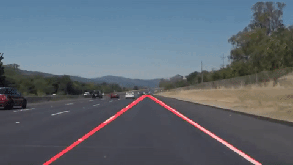

# 01 - Basic Lane Finding

Detects the left and right lane lines in a road image or video frame using only classical computer vision, with no machine learning.

> Part of [Self-Driving Car Engineer Nanodegree - Project Solutions](../README.md) - Project 1
> Status: coursework - Type: Python scripts - Language: Python (OpenCV)


<p align="center">
  <a href="https://www.youtube.com/watch?v=KlQ-8iD1EFM"></a>
  <br>Qualitative result. Click for the demo video published by the upstream author.
</p>

## Overview

The goal of this first project of the nanodegree is a simple pipeline that finds the lane lines in frames from a roof-mounted camera. The pipeline converts a frame to grayscale, extracts edges, finds line segments with a Hough transform, keeps the segments with plausible slopes and fits one line per side. For video, the lines are averaged over the last 10 frames to reduce jitter. Because it is hand-tuned, the parameters are specific to the provided test footage.

## Data

- **Source:** the Udacity test images and test videos for the project. They are not committed in this repository (the upstream repository ships six test images, such as `solidWhiteCurve.jpg`, under `data/test_images`, and one test video, `solidWhiteRight.mp4`, under `data/test_videos`).
- **Expected paths:** `data/test_images/` with images and `data/test_videos/` with videos, relative to this folder (`main.py`).
- **Outputs:** `out/images/` and `out/videos/` (`main.py` writes there but does not create them; create the folders first).

## Approach

The pipeline is implemented in [`lane_detection.py`](lane_detection.py):

1. Resize the frame to 960 x 540 and convert to grayscale.
2. Smooth with a 17 x 17 Gaussian blur.
3. Detect edges with Canny (thresholds 50 and 80).
4. Find line segments with the probabilistic Hough transform (`cv2.HoughLinesP`, rho = 2, theta = 1 degree, threshold = 1, minimum length 15 px, maximum gap 5 px).
5. Keep segments whose absolute slope is between 0.5 and 2, split them into left and right by slope sign, and take the median slope and intercept of each group to build one line per side (`compute_lane_from_candidates`).
6. For video, average the detected lines over a buffer of the last 10 frames (`smoothen_over_time`).
7. Draw the lines, mask them to a trapezoidal region of interest and blend them onto the original frame.

[`Line.py`](Line.py) defines a small `Line` class (slope, intercept, drawing).

## Results

No quantitative metric is recorded in the repository. The result is qualitative: the demo GIF above and the linked video show the lane overlay on a clip where the pipeline works. The README of the upstream repository describes the clip as a success case; failure cases are not documented.

## How to run

```bash
pip install -r requirements.txt
mkdir -p out/images out/videos        # output folders
# put test images in data/test_images/ and videos in data/test_videos/
python main.py
```

`main.py` processes every image in `data/test_images`, then every video in `data/test_videos`. It runs with `verbose = True`, which opens Matplotlib and OpenCV windows (a display is required) and waits for a key press after each image. Run it from this folder because all paths are relative.

## Project structure

```text
01-lane-finding-basic/
├── README.md
├── requirements.txt       # packages imported by the scripts
├── main.py                # runs the pipeline on test images and videos
├── lane_detection.py      # Canny + Hough pipeline and lane fitting
├── Line.py                # line helper class
└── img/
    └── overview.gif       # demo animation used in this README
```

## Limitations and known issues

- No data is included, so the script cannot be run as-is.
- The thresholds and the region-of-interest polygon are hard-coded for the 960 x 540 test footage.
- The pipeline fits straight lines only and has no handling for frames with no detected line on one side.
- Written for the OpenCV and NumPy releases of 2017; not tested here with current versions.

## Credits

- Code and write-up copied from [ndrplz/self-driving-car](https://github.com/ndrplz/self-driving-car) (`project_1_lane_finding_basic`).
- Project specification, test data and starter notebook: Udacity Self-Driving Car Engineer Nanodegree.

## License

No license file - all rights reserved by the respective authors.
