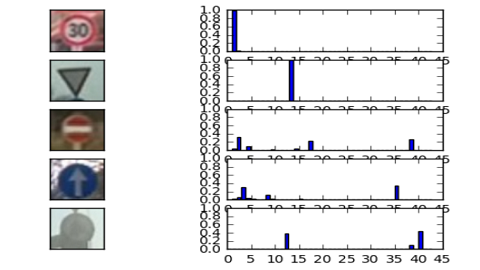

# 02 - Traffic Sign Classifier

Trains a convolutional neural network in TensorFlow to recognise 43 classes of German traffic signs and inspects how certain its predictions are.

> Part of [Self-Driving Car Engineer Nanodegree - Project Solutions](../README.md) - Project 2
> Status: coursework - Type: Jupyter notebook - Language: Python (TensorFlow, Keras, OpenCV)


<p align="center">
  
  <br>Softmax probabilities of the model for five photos that were not part of the data set.
</p>

## Overview

The notebook [`traffic-sign-classifier.ipynb`](traffic-sign-classifier.ipynb) covers dataset exploration, preprocessing, augmentation, model training and testing on the German Traffic Sign Benchmark, then evaluates the trained model on five traffic sign photos taken from real-world videos. The network reaches **0.953 accuracy on the 12,630-image test set** (output of the notebook, cell 26). On five new images it gets 4 of 5 right, which is too few to be statistically meaningful.

## Data

- **Source:** [German Traffic Sign Benchmark (GTSRB)](http://benchmark.ini.rub.de/?section=gtsrb&subsection=dataset), in the pickled 32 x 32 form used by the Udacity project (`train.p`, `test.p`).
- **Contents (from the notebook output):** 39,209 training examples, 12,630 test examples, image shape (32, 32, 3), 43 classes.
- **Expected paths (relative to this folder):** `../traffic_signs_data/train.p`, `../traffic_signs_data/test.p` and, for the new images, `../other_signs/`. Checkpoints are written to `../checkpoints/`. None of these are committed; they sit one level above this folder in the original layout.
- **Not committed:** the pickled data, the five extra images and the checkpoints.

## Approach

1. **Preprocessing:** convert RGB to YUV and keep only the Y channel, equalize the histogram, then standardize each pixel position to zero mean and unit standard deviation across the images in the array being processed. This follows Sermanet and LeCun's traffic sign paper.
2. **Validation split:** 20% of the training set (`random_state=0`) is held out for validation. The provided test set is used only for the final evaluation.
3. **Augmentation:** Keras `ImageDataGenerator` with rotation up to 15 degrees, zoom 0.2 and width/height shifts of 0.1, applied online.
4. **Model:** two 3 x 3 convolution blocks (64 and 128 filters, ReLU, 2 x 2 max pooling, dropout). The flattened outputs of both blocks are concatenated (multi-scale features), then passed through a 64-unit fully connected layer with dropout and a 43-way output layer.
5. **Training:** Adam with learning rate 0.001, batch size 128, dropout keep probability 0.5, 30 epochs of 5,000 augmented batches each. Training and validation accuracy are printed after every epoch and a checkpoint is saved.
6. **Evaluation:** the notebook restores checkpoint `traffic_sign_model.ckpt-27` for testing, then predicts five new images and plots the top-3 softmax scores.

## Results

| Evaluation | Accuracy | Source |
|---|---|---|
| Best printed validation accuracy | 0.994 (epoch 27 of 30) | Notebook cell 24 output |
| Last epoch (30), train / validation | 0.996 / 0.991 | Notebook cell 24 output |
| Test set (12,630 images) | 0.953 | Notebook cell 26 output |
| Five new images | 0.80 (4 of 5 correct) | Notebook cell 37 output |

Cell numbers are zero-based positions in the notebook file (the first cell is cell 0).

Caveats:

- The test accuracy comes from a single training run and a single train/validation split.
- `preprocess_features` computes the mean and standard deviation from the array it is given, so the training and test sets are each standardized with their own statistics rather than with the training statistics.
- The checkpoint is chosen from validation results. The checkpoint index in the code is zero-based (`global_step=epoch`), so `ckpt-27` was saved after the 28th printed epoch (validation 0.992), not the epoch with the printed best of 0.994.
- Five new images are too few to estimate generalization. The one miss was the "no entry" sign (class 17), predicted as class 2 with confidence 0.31; class 17 was third in the top-3 with confidence 0.22 (cell 41 output).

## How to run

```bash
pip install -r requirements.txt   # use an old TensorFlow/Keras environment, see below
jupyter notebook traffic-sign-classifier.ipynb
```

1. Place `train.p` and `test.p` in `../traffic_signs_data/` (relative to this folder) and the extra images in `../other_signs/`.
2. Run the cells in order. Training writes checkpoints to `../checkpoints/` and the later cells restore from there.

The notebook uses TensorFlow idioms from before 1.0 (for example `tf.concat(1, [...])` with the axis first, which TensorFlow 1.0 removed) as well as `tensorflow.contrib`, together with Keras for augmentation. It needs a matching legacy TensorFlow environment (the notebook metadata records Python 3.5.2) and will not run unchanged on current TensorFlow.

## Project structure

```text
02-traffic-sign-classifier/
├── README.md
├── requirements.txt                    # packages imported by the notebook
├── traffic-sign-classifier.ipynb       # full solution with executed outputs
└── img/
    ├── softmax.png                     # figure used in this README
    └── overview.gif                    # 32 x 32 px animated preview (not used in the text)
```

## Limitations and known issues

- Data, extra images and checkpoints are not committed, so the notebook cannot be re-run from this repository alone.
- Legacy TensorFlow API (see "How to run").
- The notebook's written answers are in the voice of the original author; they are kept as published.

## Credits

- Notebook and write-up copied from [ndrplz/self-driving-car](https://github.com/ndrplz/self-driving-car) (`project_2_traffic_sign_classifier`).
- Project template and data preparation: Udacity Self-Driving Car Engineer Nanodegree.
- Data set: German Traffic Sign Recognition Benchmark (GTSRB), hosted by the Institut fur Neuroinformatik at Ruhr-Universitat Bochum (link above).
- Method: P. Sermanet and Y. LeCun, "Traffic sign recognition with multi-scale convolutional networks" (IJCNN 2011), linked from the notebook.

## License

No license file - all rights reserved by the respective authors.
