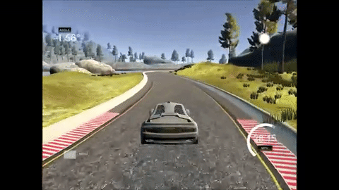
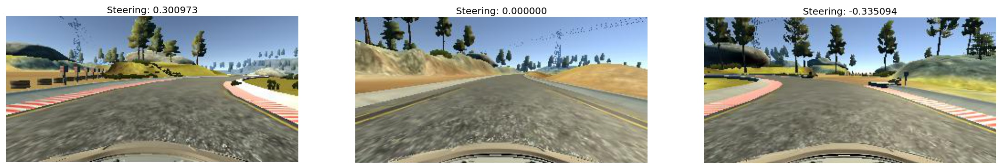
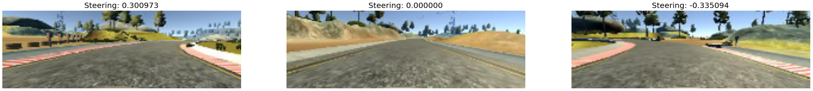
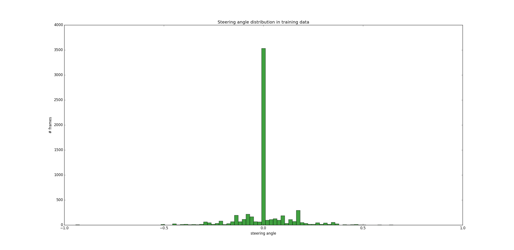
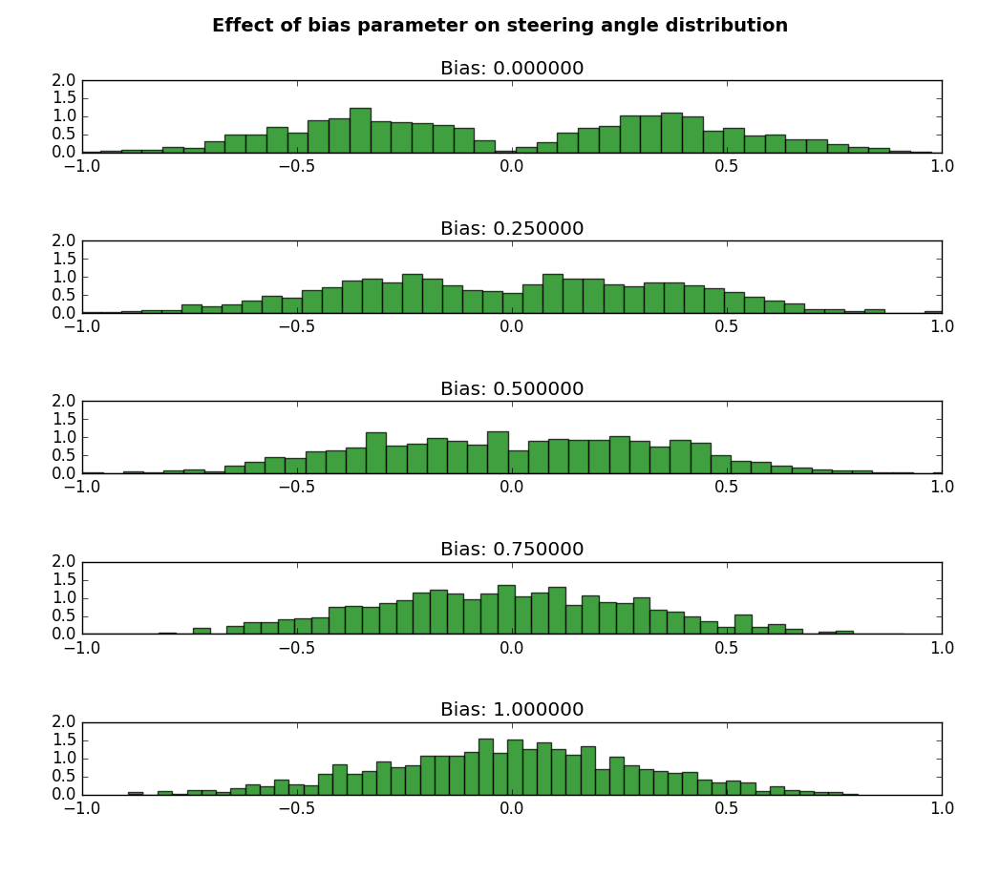
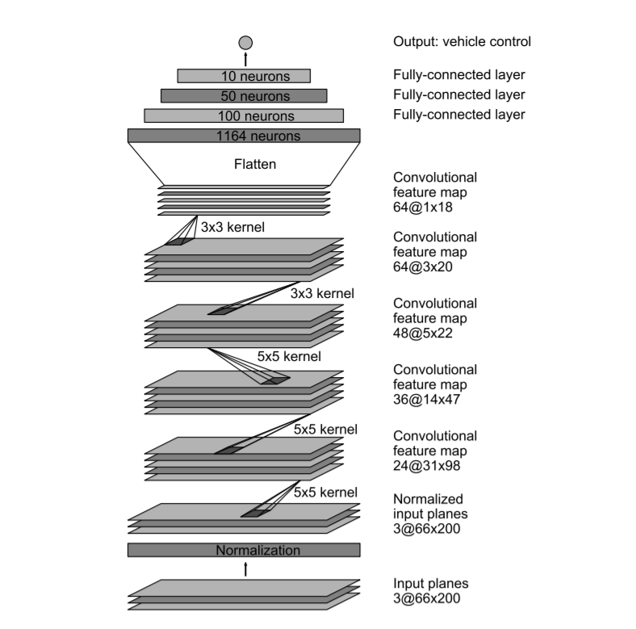

# 03 - Behavioral Cloning

Trains a convolutional neural network to imitate human steering: given the frame of a front-facing camera, it predicts the steering angle for the Udacity driving simulator.

> Part of [Self-Driving Car Engineer Nanodegree - Project Solutions](../README.md) - Project 3
> Status: coursework - Type: Python scripts - Language: Python (Keras, TensorFlow, OpenCV)


<p align="center">
  <a href="https://www.youtube.com/watch?v=gXkMELjZmCc"></a>
  <br>Qualitative result. Click for the demo video published by the upstream author.
</p>

## Overview

In training mode the simulator records frames from three cameras (centre, left, right) together with the human steering angle. This project regresses the steering angle from the preprocessed frame with an NVIDIA-style CNN, and uses heavy augmentation and dropout so that a network trained on one track can generalise to another. A client script, [`drive.py`](drive.py), serves the trained model to the simulator over a WebSocket and applies a constant throttle.

## Data

- **Source:** the sample driving data that Udacity provides for the project (recorded in the simulator; the file names contain 2016-12-01 timestamps). A driving log can also be recorded in the simulator's training mode.
- **Committed:** [`data/driving_log.csv`](data/driving_log.csv), with 8,036 samples (8,037 lines including the header). Columns: `center, left, right, steering, throttle, brake, speed`. In this log, 4,361 of the 8,036 steering values are exactly 0.
- **Not committed:** the frames. The code expects `data/IMG/center_*.jpg`, `left_*.jpg` and `right_*.jpg`, as referenced in the CSV (`IMG/...`).
- **Also not committed:** the trained weights `pretrained/model.hdf5` (ignored by `.gitignore` and absent from the repository). Only the architecture, `pretrained/model.json`, is present. The upstream repository publishes a copy of `pretrained/model.hdf5` (about 3 MB); it was not verified here that it loads with `drive.py`.

### Exploring the data

A typical sample has three frames and the associated steering angle:



Each frame is cropped (rows 20 to 139) to drop the sky and the car bonnet, then resized to 200 x 66 pixels (`preprocess` in [`load_data.py`](load_data.py)):



The steering distribution is strongly skewed towards zero:



## Approach

1. **Split:** 80% training and 20% validation (`train_test_split`, `random_state=1`), done on the rows of the CSV.
2. **Camera selection:** each training example randomly uses the centre, left or right frame. For side frames the angle is corrected by +0.25 (left) or -0.25 (right), as in the NVIDIA paper (`delta_correction` in [`config.py`](config.py)).
3. **Augmentation (training only):**
   - random horizontal flip with the steering angle negated;
   - Gaussian noise on the steering angle (mean 0, standard deviation 0.2);
   - random brightness change by scaling the HSV value channel by a factor in [0.2, 1.5].
4. **Bias balancing:** a `bias` parameter controls how aggressively near-zero steering examples are discarded. A sample is rejected when `abs(steering) + bias` is smaller than a uniform random number; training uses `bias = 0.8`, validation uses `bias = 1.0` and no augmentation (the camera is still chosen at random, with the angle correction for side cameras).

   

5. **Model** ([`model.py`](model.py)): the architecture from NVIDIA's "End to End Learning for Self-Driving Cars". Input normalization `z / 127.5 - 1` in a `Lambda` layer, five convolution layers (24, 36, 48 filters of 5 x 5 with stride 2, then 64 and 64 filters of 3 x 3), fully connected layers of 100, 50 and 10 units, and a single output neuron. ELU activations, dropout 0.2 after each convolution and 0.5 after the first two dense layers.

   

6. **Training:** Adam with default parameters and mean squared error loss, batches of 512, 300 batches per epoch, up to 50 epochs, validation on 100 batches per epoch. The loss history is logged to `logs/history.csv` and weights to `checkpoints/`.
7. **Driving:** `drive.py` loads `pretrained/model.json` and `pretrained/model.hdf5`, preprocesses each incoming frame, predicts the steering angle and sends it back with a throttle of 0.28.

## Results

| Quantity | Value | Source |
|---|---|---|
| Epochs recorded | 17 (index 0 to 16) | [`logs/history.csv`](logs/history.csv) |
| Training loss (MSE), epoch 0 to 16 | 0.0787 to 0.0575 | `logs/history.csv` |
| Validation loss (MSE), epoch 0 to 16 | 0.0258 to 0.0157 | `logs/history.csv` |

Caveats:

- The training loss is measured on augmented, dropout-regularised batches and the validation loss on un-augmented ones, so the two are not directly comparable.
- The driving behaviour in the simulator (on both tracks) is reported only qualitatively, through the demo video of the upstream author. It cannot be reproduced from this repository because the frames and the trained weights are not included.
- Mean squared error on the steering angle is not a driving-quality metric.

## How to run

```bash
pip install -r requirements.txt     # needs Keras 1.x and TensorFlow 1.x, see below
# put the Udacity frames in data/IMG/ (the CSV is already in data/)
mkdir -p checkpoints
python model.py                     # train; writes logs/ and checkpoints/
python drive.py                     # start the server, then run the simulator in autonomous mode
```

- `drive.py` expects `pretrained/model.hdf5`, which has to be created by training (copy a checkpoint to that name) or obtained separately. It listens on port 4567.
- `python visualize_data.py` plots the steering distribution and the effect of `bias`; `python visualize_activations.py` saves activation maps of the convolution layers (it reads `logs/model.json` and weights from `checkpoints/`).
- Run every script from this folder; the paths are relative.
- The code uses Keras 1.x APIs (`Convolution2D(..., border_mode=, subsample=, init=)`, `fit_generator(samples_per_epoch=, nb_epoch=)`); `pretrained/model.json` was written by Keras 1.1.2. It will not run unchanged on Keras 2 or later.

## Project structure

```text
03-behavioral-cloning/
├── README.md
├── requirements.txt
├── config.py                 # hyperparameters and input size
├── load_data.py              # preprocessing, augmentation, batch generator
├── model.py                  # network definition and training
├── drive.py                  # simulator client that drives with the model
├── visualize_data.py         # exploratory plots used in the figures above
├── visualize_activations.py  # activation maps of the trained network
├── data/
│   └── driving_log.csv       # Udacity sample log (frames not included)
├── logs/
│   ├── history.csv           # per-epoch loss and validation loss
│   └── model.json            # architecture written by model.py
├── pretrained/
│   └── model.json            # architecture used by drive.py (weights not included)
└── img/                      # figures used in this README
```

## Limitations and known issues

- Frames and trained weights are missing, so neither training nor autonomous driving works out of the box.
- `logs/model.json` and `pretrained/model.json` are identical; both are kept because `visualize_activations.py` reads one and `drive.py` the other.
- Legacy Keras 1.x and TensorFlow 1.x code. `drive.py` patches `tf.python.control_flow_ops` for an old Keras/TensorFlow combination.
- The throttle is a fixed value (0.28) and is not predicted by the model, so speed is not controlled.

## Credits

- Code and write-up copied from [ndrplz/self-driving-car](https://github.com/ndrplz/self-driving-car) (`project_3_behavioral_cloning`).
- Simulator, sample data and project specification: Udacity Self-Driving Car Engineer Nanodegree.
- Architecture: M. Bojarski et al., NVIDIA, [End to End Learning for Self-Driving Cars](https://arxiv.org/abs/1604.07316). The upstream write-up attributes the ELU activation choice to a [comma.ai steering model](https://github.com/commaai/research/blob/master/train_steering_model.py); `model.py` itself describes the input normalization and ELU activations as the author's implementation choices.

## License

No license file - all rights reserved by the respective authors.
