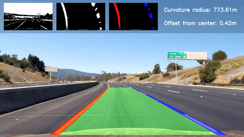
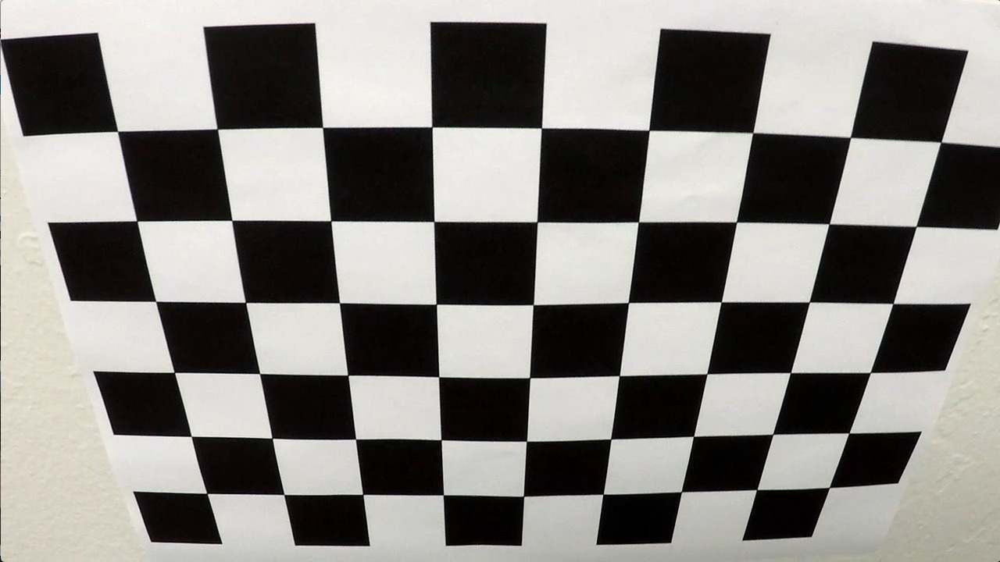
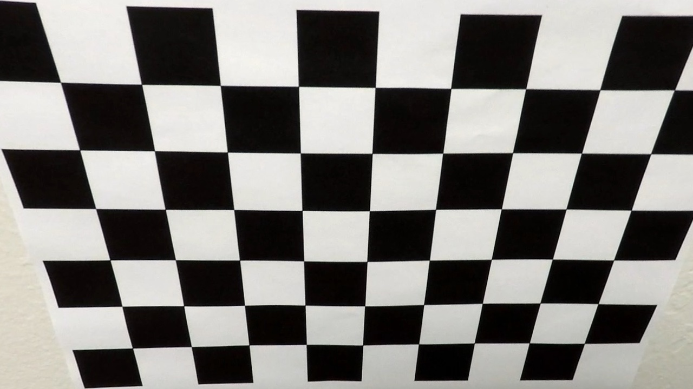
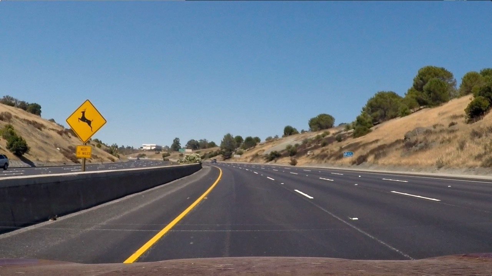
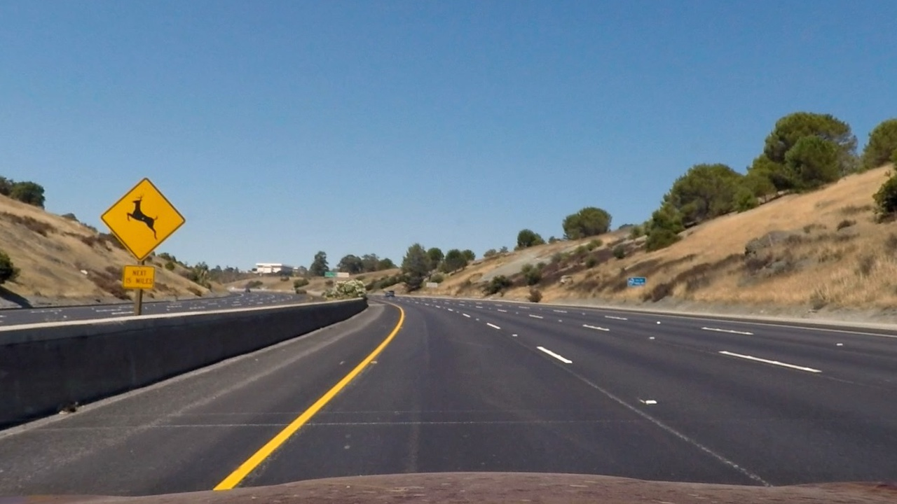
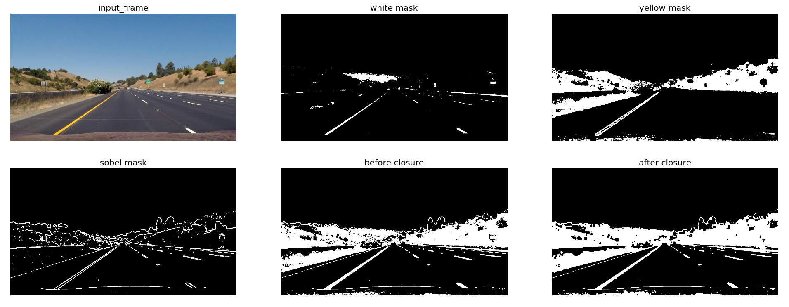
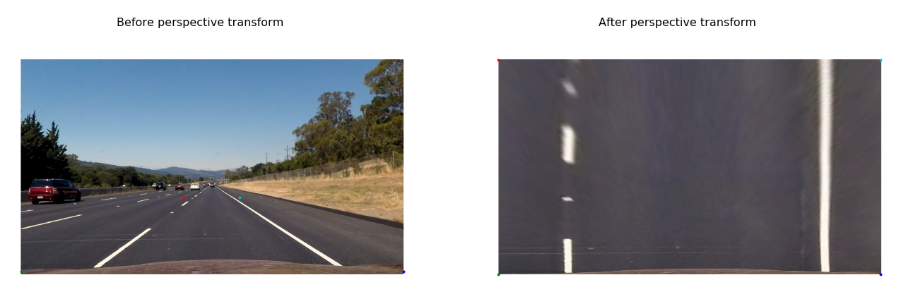
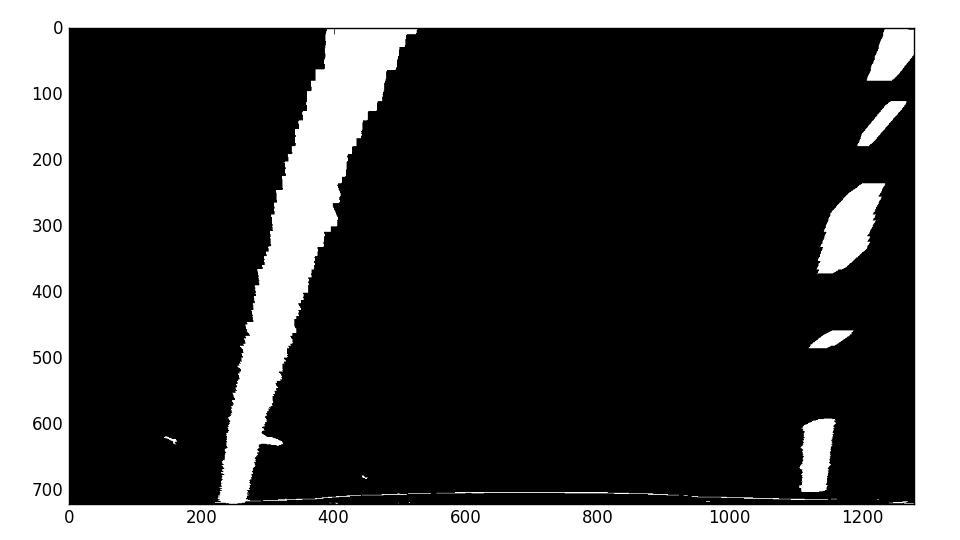
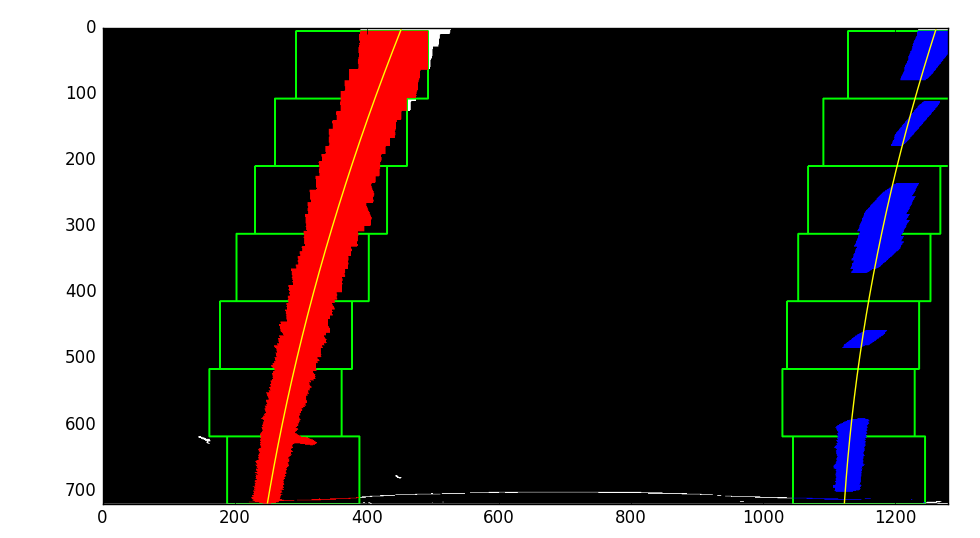
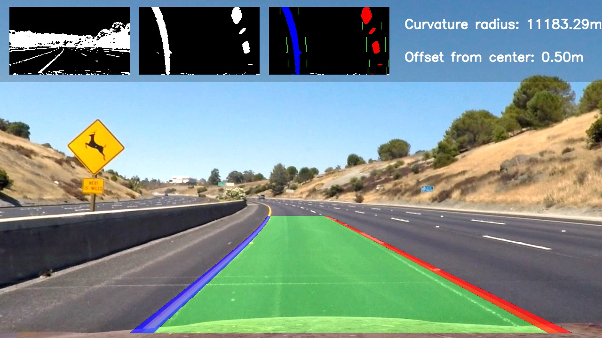

# 04 - Advanced Lane Finding

Finds the lane boundaries in dashboard-camera video and reports the lane curvature and the vehicle's offset from the lane centre, using camera calibration, thresholding, a perspective transform and polynomial fitting.

> Part of [Self-Driving Car Engineer Nanodegree - Project Solutions](../README.md) - Project 4
> Status: coursework - Type: Python scripts - Language: Python (OpenCV, MoviePy)


<p align="center">
  <a href="https://www.youtube.com/watch?v=g5BhDtoheE4"></a>
  <br>Qualitative result. Click for the full video published by the upstream author.
</p>

## Overview

The pipeline processes each frame in the following steps: undistort, binarize so that the lane lines stand out, warp to a bird's-eye view, find the lane pixels and fit a second-order polynomial to each line, compute the curvature and the offset from the lane centre, and draw the detected lane back onto the road. On video it reuses the previous frame's fit to speed up the search and averages the fits over the last 10 frames. The binarization step is the most fragile part: if the thresholds fail, later steps cannot recover.

## Data

- **Source:** Udacity's project starter files: chessboard images for calibration, test road images and the project video.
- **Committed:** the cached calibration [`camera_cal/calibration_data.pickle`](camera_cal/calibration_data.pickle). The code loads it when present, so the chessboard images are not needed to run the pipeline. [`output_images/`](output_images/) holds the pipeline output for eight test images.
- **Not committed:** the chessboard images (`camera_cal/calibration*.jpg`, only needed to recompute the calibration), the test images (`test_images/`) and the video (`project_video.mp4`). The scripts expect them in this folder. The upstream repository publishes them (20 chessboard images, `test_images/` with the eight test images, and `project_video.mp4` of about 25 MB).

## Approach

1. **Camera calibration** ([`calibration_utils.py`](calibration_utils.py)): detect the 9 x 6 inner chessboard corners with `cv2.findChessboardCorners`, calibrate with `cv2.calibrateCamera` and cache the result.

   | Chessboard before | Chessboard after |
   |---|---|
   |  |  |

2. **Distortion correction** with `cv2.undistort`. The effect is easiest to see near the image borders.

   | Test image before | Test image after |
   |---|---|
   |  |  |

3. **Binarization** ([`binarization_utils.py`](binarization_utils.py)): the union of three masks, then a 5 x 5 morphological closing to fill gaps.
   - white lines: grayscale, histogram equalization, threshold at 250;
   - yellow lines: HSV threshold between (0, 70, 70) and (50, 255, 255);
   - gradients: Sobel magnitude (kernel size 9), thresholded at 50.

   <p align="center"></p>

4. **Perspective transform** (`birdeye` in [`perspective_utils.py`](perspective_utils.py)). Four hard-coded source points (bottom right and left at `h-10`, top left at (546, 460), top right at (732, 460)) are mapped to the image corners. Drawing the points on a test image and its warped version confirms that the lane lines come out parallel.

   <p align="center"></p>

5. **Lane pixels and polynomial fit** ([`line_utils.py`](line_utils.py)). For a new frame, `get_fits_by_sliding_windows` starts at the peaks (one per image half) of the column histogram of the lower half of the binary image and slides 9 windows (margin 100 px, recentred when more than 50 pixels are found) upwards. When both lines were detected in the previous frame, `get_fits_by_previous_fits` searches within 100 px of the previous fit instead. A `Line` class keeps the recent fits (buffer of 10 frames) and `np.polyfit` fits a second-order polynomial to each line, in pixels and in metres.

   | Bird's-eye view (binary) | Lane found |
   |---|---|
   |  |  |

6. **Curvature and offset** (`Line.curvature_meter` and `compute_offset_from_center` in [`main.py`](main.py)). Curvature comes from the polynomial coefficients using the pixel-to-metre factors in [`globals.py`](globals.py) (3.7 m per 700 px horizontally, 30 m per 720 px vertically). The offset assumes the camera is mounted at the centre of the car: it is the distance between the image centre and the midpoint of the two detected lines at the bottom of the image.
7. **Output** (`process_pipeline` in `main.py`): the lane area is warped back onto the undistorted frame and the thumbnails of intermediate steps, the curvature radius and the offset are overlaid.

   <p align="center"><br>Result for <code>test2.jpg</code>; the other test images are in <a href="output_images/">output_images/</a>.</p>

## Results

| Quantity | Value | Source |
|---|---|---|
| RMS re-projection error of the cached calibration | 1.19 px | First element of `camera_cal/calibration_data.pickle` (the value returned by `cv2.calibrateCamera`) |

No quantitative lane-detection accuracy is recorded. The results are qualitative: the images in [`output_images/`](output_images/) and the demo video above.

## How to run

```bash
pip install -r requirements.txt
# place test_images/ and (for video) project_video.mp4 in this folder
python main.py
```

- `main.py` has a `mode` variable near the bottom. With `mode = 'images'` (the default in the source) it processes every file in `test_images/`, writes the result to `output_images/` and shows it with Matplotlib. With `mode = 'video'` it processes `project_video.mp4` and writes `out_project_10.mp4` with MoviePy. Edit the file to switch.
- If `camera_cal/calibration_data.pickle` is missing, the chessboard images in `camera_cal/` are used to compute and cache it.
- Run from this folder because the paths are relative.

## Project structure

```text
04-advanced-lane-finding/
├── README.md
├── requirements.txt
├── main.py                  # full pipeline for images and video
├── calibration_utils.py     # camera calibration and undistortion
├── binarization_utils.py    # colour and gradient thresholds
├── perspective_utils.py     # bird's-eye perspective transform
├── line_utils.py            # lane search, polynomial fit, Line class
├── globals.py               # pixel-to-metre factors, smoothing window
├── camera_cal/
│   └── calibration_data.pickle   # cached camera calibration
├── output_images/           # pipeline output for the eight test images
└── img/                     # figures used in this README (and the demo GIF)
```

## Limitations and known issues

- Test images, chessboard images and the project video are not committed.
- The source and destination points of the perspective transform and the thresholds are hard-coded for the project video's camera.
- Binarization by fixed thresholds is the single point of failure; the author of the upstream write-up suggests a learned lane-marking segmentation as a more robust alternative (not implemented).
- `calibration_utils.py` writes `img/test_calibration_*.jpg` when run directly, which would overwrite the figures above.

## Credits

- Code and write-up copied from [ndrplz/self-driving-car](https://github.com/ndrplz/self-driving-car) (`project_4_advanced_lane_finding`).
- Project specification, [rubric](https://review.udacity.com/#!/rubrics/571/view), calibration images, test images and video: Udacity Self-Driving Car Engineer Nanodegree.

## License

No license file - all rights reserved by the respective authors.
