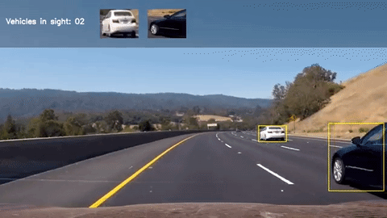
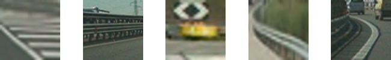
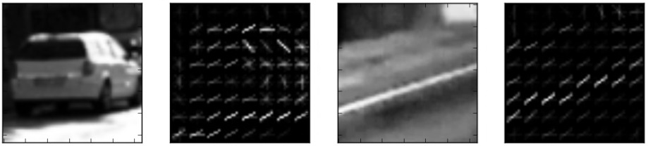
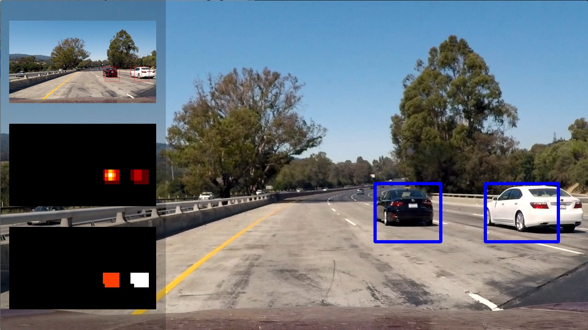
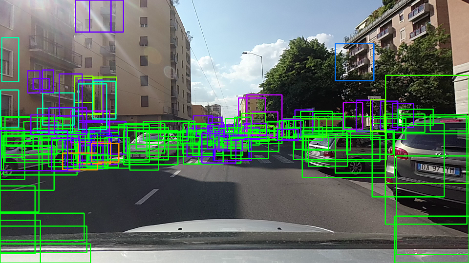
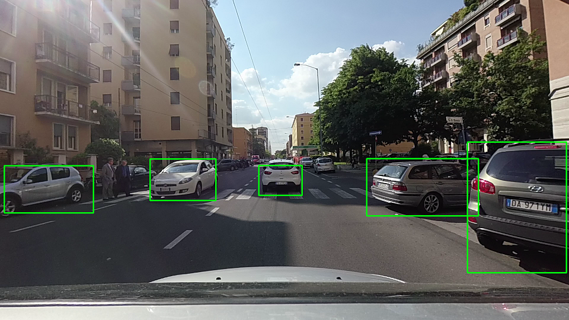

# 05 - Vehicle Detection

Detects cars in highway video from a roof-mounted camera, first with a classical HOG + linear SVM pipeline and then with a pretrained SSD deep network.

> Part of [Self-Driving Car Engineer Nanodegree - Project Solutions](../README.md) - Project 5
> Status: coursework - Type: Python scripts - Language: Python (scikit-learn, scikit-image, Keras, OpenCV)


<p align="center">
  <a href="https://www.youtube.com/watch?v=Cd7p5pnP3e0"></a>
  <br>Qualitative result. Click for the full video published by the upstream author.
</p>

## Overview

The project has two detectors for the same task:

- **Baseline:** colour histograms, spatial features and HOG features feed a linear SVM that classifies image patches as car or non-car. A multi-scale window search, a heat map accumulated over frames and a threshold remove false positives.
- **Submission:** the [SSD300](https://arxiv.org/pdf/1512.02325.pdf) detector, pretrained on the 20 Pascal VOC classes, is run on each frame and only the `Car` class above a confidence threshold is kept. Its detections were precise enough that, according to the upstream write-up, integrating them over time was not needed.

## Data

- **HOG + SVM training data:** labelled car and non-car image patches provided with the Udacity project, read from two directory trees. They are **not committed**. The paths are set in [`config.py`](config.py) as `root_data_vehicle` and `root_data_non_vehicle` and currently point to `../../../NANODEGREE/term_1/project_5_vehicle_detection/vehicles` and `.../non-vehicles` (a layout from the original author's computer). Edit them to your own location.
- **Committed training outputs:** [`data/svm_trained.pickle`](data/svm_trained.pickle), [`data/feature_scaler.pickle`](data/feature_scaler.pickle) and [`data/feat_extraction_params.pickle`](data/feat_extraction_params.pickle), used by `main_hog.py`. They are pickled scikit-learn objects and are sensitive to the scikit-learn version.
- **SSD weights:** `SSD.py` downloads `weights_SSD300.hdf5` from `http://imagelab.ing.unimore.it/files/model_weights/SSD/` on first use (`WEIGHTS_URL`).
- **Test images and video:** `test_images/` and `project_video.mp4`, from Udacity, are expected in this folder and are not committed (the upstream repository ships six test images in `test_images/`, but not the video). Both mains write results to `output_images/`, which must exist.

Example training patches:

<p align="center">
  <br>Randomly sampled car patches<br><br>
  <br>Randomly sampled non-car patches
</p>

## Approach

### Baseline: HOG + linear SVM

1. **Features** ([`functions_feat_extraction.py`](functions_feat_extraction.py), parameters in [`config.py`](config.py)): patches are resized to 64 x 64 and converted to YCrCb. The feature vector concatenates spatial binning (32 x 32), colour histograms (16 bins per channel) and HOG on all channels (9 orientations, 8 x 8 pixel cells, 2 x 2 cells per block).

   <p align="center"><br>HOG representation of a car patch (left) and a non-car patch (right)</p>

2. **Classifier** ([`train.py`](train.py)): features are standardized with `StandardScaler` and a `LinearSVC` is trained on an 80/20 split with a random seed drawn at run time. The script prints the test accuracy and saves the classifier, the scaler and the parameters to `data/`.
3. **Detection** ([`main_hog.py`](main_hog.py)): `find_cars` computes HOG features once for a region of interest (image rows 400 to 600) and subsamples them at scales 1, 1.5, 2 and 2.5, instead of recomputing features for every window. Positive windows are accumulated in a heat map, thresholded, and the connected components are labelled (`scipy.ndimage.label`) and drawn as boxes. `process_pipeline` can combine the windows of the last 5 frames (`keep_state=True`, heat-map threshold 4), which is meant for video; the script entry point runs on single test images with `keep_state=False` (threshold 0).

   <p align="center"><br>Result of the HOG pipeline on a test image</p>

### Deep learning: SSD

[`main_ssd.py`](main_ssd.py) runs the Keras SSD300 model from [`SSD.py`](SSD.py) (pretrained on Pascal VOC, 21 outputs including background) and keeps detections of the `Car` label (label index 7) with confidence above 0.3. Overlapping boxes are merged by keeping the larger one, and each detected vehicle is shown as a thumbnail with a counter. The network detects and classifies in one pass, needs no hand-tuned features and returns a confidence score, so the precision/recall trade-off is set by a single threshold:

| Minimum confidence 0.01 | Minimum confidence 0.50 |
|---|---|
|  |  |

## Results

No quantitative result (accuracy, precision, recall or frame rate) is recorded in the repository. The classifier accuracy printed by `train.py` is not stored, and varies between runs because the train/test split is random. Results are qualitative: the figures above and the demo video. The upstream write-up reports that a hand-tuned HOG + SVM pipeline worked on the project video but was fragile to the chosen parameters, and that SSD was more robust with fewer false positives; these statements were not re-checked here.

## How to run

```bash
pip install -r requirements.txt     # SSD.py needs Keras 1.x; see below
mkdir -p output_images
# HOG + SVM
#   1. edit config.py: root_data_vehicle / root_data_non_vehicle
python train.py                     # optional: retrain; writes data/*.pickle
python main_hog.py                  # reads test_images/, writes output_images/
# SSD
python main_ssd.py                  # reads test_images/, writes output_images/ (downloads weights on first run)
```

- Run from this folder: all other paths are relative.
- `main_ssd.py` has a `mode` variable in `__main__`. With `mode = 'video'` it processes `project_video.mp4` and writes frames to `../../../NANODEGREE/term_1/project_5_vehicle_detection/frames_out` (line 81); edit this path first.
- `SSD.py` uses Keras 1.x layers (`AtrousConvolution2D`, `merge`), and `functions_feat_extraction.py` uses the old scikit-image `hog(..., visualise=...)` argument. Use a matching legacy environment.

## Project structure

```text
05-vehicle-detection/
├── README.md
├── requirements.txt
├── config.py                       # data paths and feature-extraction parameters
├── train.py                        # trains the HOG + LinearSVC classifier
├── main_hog.py                     # HOG + SVM pipeline on test images
├── main_ssd.py                     # SSD pipeline on test images or video
├── SSD.py                          # Keras SSD300 model, weights loader, helpers
├── vehicle.py                      # bounding-box helper class
├── functions_feat_extraction.py    # HOG / colour / spatial features, find_cars
├── functions_detection.py          # windows, heat map, labelled boxes
├── functions_utils.py              # image normalization helper
├── project_5_utils.py              # file listing and rectangle helpers
├── process_video.py                # ad-hoc SSD demo script (hard-coded paths)
├── data/                           # trained SVM, scaler and parameters (pickles)
└── img/                            # figures used in this README (and the demo GIF)
```

## Limitations and known issues

- Training data, test images and video are not committed, and `config.py` points to a path on the original author's computer.
- `process_video.py` is a one-off demo with hard-coded Windows paths (`C:/Users/...`, `C:/temp_frames`) and is not part of the pipeline. It is kept for reference and will not run without editing.
- Pickled scikit-learn objects and the old Keras/scikit-image APIs tie the code to 2017-era releases.
- Accuracy and speed are not measured in the repository.

## Credits

- Code and write-up copied from [ndrplz/self-driving-car](https://github.com/ndrplz/self-driving-car) (`project_5_vehicle_detection`).
- SSD Keras implementation adapted from [rykov8/ssd_keras](https://github.com/rykov8/ssd_keras); SSD paper: W. Liu et al., [SSD: Single Shot MultiBox Detector](https://arxiv.org/pdf/1512.02325.pdf). The pretrained weights are downloaded from the host named in `SSD.py`.
- HOG descriptor: N. Dalal and B. Triggs, "Histograms of Oriented Gradients for Human Detection" (2005).
- Project specification, [rubric](https://review.udacity.com/#!/rubrics/513/view), data and test media: Udacity Self-Driving Car Engineer Nanodegree.

## License

No license file - all rights reserved by the respective authors.
