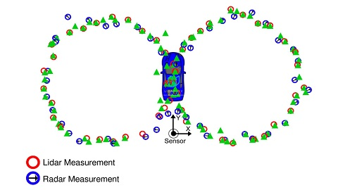

# 06 - Extended Kalman Filter

Fuses simulated lidar and radar measurements of a bicycle travelling around a vehicle with an Extended Kalman Filter (EKF) written in C++, and reports the tracking error as RMSE.

> Part of [Self-Driving Car Engineer Nanodegree - Project Solutions](../README.md) - Project 6
> Status: coursework - Type: C++ command-line program - Language: C++11 (Eigen, CMake)


<p align="center">
  
  <br>Setup: lidar and radar measurements of a moving object around the sensor.
</p>

## Overview

A lidar measures the position of the object directly (x, y) and a radar measures range, bearing and range rate (rho, phi, rho_dot) in polar coordinates. The filter keeps a four-dimensional state (px, py, vx, vy) and updates it with whichever sensor delivers the next measurement. The lidar update is linear; the radar measurement function is nonlinear, so the EKF linearises it with a Jacobian at the current state. The program reads a text file of interleaved measurements with ground truth and prints the RMSE of the estimates.

## Data

Three input files are committed in [`data/`](data/); they are loaded from the command line:

| File | Lines |
|---|---|
| `obj_pose-laser-radar-synthetic-input.txt` | 500 |
| `sample-laser-radar-measurement-data-1.txt` | 1,224 |
| `sample-laser-radar-measurement-data-2.txt` | 200 |

Each line starts with the sensor type. Lidar: `L meas_px meas_py timestamp gt_px gt_py gt_vx gt_vy`. Radar: `R meas_rho meas_phi meas_rho_dot timestamp gt_px gt_py gt_vx gt_vy`. Timestamps are in microseconds. The file `obj_pose-laser-radar-synthetic-input.txt` has two extra ground-truth columns after `gt_vy` that the program does not read. See [`docs/`](docs/) for the format notes. The data comes from the Udacity project starter material.

## Approach

1. **State and model** ([`src/FusionEKF.cpp`](src/FusionEKF.cpp)): state (px, py, vx, vy), constant-velocity transition matrix `F` updated with the elapsed time `dt`, process noise from acceleration noise `noise_ax = noise_ay = 9`, initial covariance `P = diag(1, 1, 1000, 1000)`.
2. **Initialization:** the first measurement sets the state. A radar measurement is converted from polar to Cartesian coordinates; a lidar measurement sets the position with zero velocity.
3. **Predict** (`KalmanFilter::Predict` in [`src/kalman_filter.cpp`](src/kalman_filter.cpp)): `x = F x`, `P = F P F^T + Q`.
4. **Update:**
   - lidar: linear update with `H = [[1, 0, 0, 0], [0, 1, 0, 0]]` and `R = diag(0.0225, 0.0225)`;
   - radar: the predicted state is mapped to (rho, phi, rho_dot) and the innovation angle is normalized to [-pi, pi]; the Jacobian `Hj` from `Tools::CalculateJacobian` ([`src/tools.cpp`](src/tools.cpp)) replaces `H`, with `R = diag(0.09, 0.0009, 0.09)`.
5. **Evaluation:** `Tools::CalculateRMSE` compares the estimates with the ground-truth columns of the input file.

## Results

RMSE of (px, py, vx, vy), obtained by building the committed code with g++ 13.3 and CMake 3.28 and running it on each committed data file. The numbers are not stored in the repository; the program prints them and writes them to `accuracy.txt` in the working directory.

| Input file | px | py | vx | vy |
|---|---|---|---|---|
| `obj_pose-laser-radar-synthetic-input.txt` | 0.097 | 0.085 | 0.451 | 0.440 |
| `sample-laser-radar-measurement-data-1.txt` | 0.065 | 0.061 | 0.533 | 0.544 |
| `sample-laser-radar-measurement-data-2.txt` | 0.185 | 0.190 | 0.477 | 0.804 |

Caveats: the data is synthetic, the RMSE includes the first (initialization) measurement, and the filter uses both sensors only. A comparison with lidar-only or radar-only filtering is not implemented in this project.

## How to run

Requirements: `cmake >= 3.5`, `make >= 4.1`, `gcc/g++ >= 5.4`. Eigen 3.2.10 is vendored in `src/Eigen/`. No simulator is needed.

```bash
mkdir build && cd build
cmake .. && make
./ExtendedKF ../data/obj_pose-laser-radar-synthetic-input.txt output.txt
```

The second argument is the output file; each line holds `est_px est_py est_vx est_vy meas_px meas_py gt_px gt_py gt_vx gt_vy`. The RMSE is printed and also saved to `accuracy.txt` in the working directory.

## Project structure

```text
06-extended-kalman-filter/
├── README.md
├── CMakeLists.txt              # builds the ExtendedKF executable
├── .gitignore                  # ignores build/ and editor files
├── data/                       # three input files with lidar/radar measurements and ground truth
├── docs/                       # notes on the file formats (see docs/README.md)
├── img/overview.jpg            # figure used in this README
└── src/
    ├── main.cpp                # reads the input file, runs the filter, writes output and RMSE
    ├── FusionEKF.{h,cpp}       # sensor fusion logic and noise settings
    ├── kalman_filter.{h,cpp}   # predict and update steps (linear and extended)
    ├── tools.{h,cpp}           # RMSE and Jacobian
    ├── measurement_package.h, ground_truth_package.h
    └── Eigen/                  # vendored Eigen 3.2.10 headers
```

## Limitations and known issues

- The first measurement is used only to initialise the state (no predict or update step is run for it), and the initial velocity covariance is large (1000).
- Fixed noise parameters; no consistency check such as NIS is implemented here (see project 07 for the unscented filter, which does).
- The RMSE values above were produced once, on a single machine, and have not been independently reviewed.

## Credits

- Solution code copied from [ndrplz/self-driving-car](https://github.com/ndrplz/self-driving-car) (`project_6_extended_kalman_filter`).
- Project specification, starter code and build setup, data files and documentation notes: Udacity Self-Driving Car Engineer Nanodegree.
- [Eigen](https://eigen.tuxfamily.org) 3.2.10, Mozilla Public License 2.0, vendored in `src/Eigen/`.

## License

No license file - all rights reserved by the respective authors. Eigen keeps its own license (MPL 2.0).
