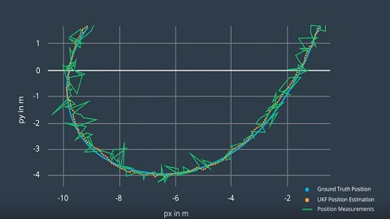

# 07 - Unscented Kalman Filter

Tracks a moving object from noisy lidar and radar measurements with an Unscented Kalman Filter (UKF) and a nonlinear constant turn rate and velocity (CTRV) motion model, written in C++.

> Part of [Self-Driving Car Engineer Nanodegree - Project Solutions](../README.md) - Project 7
> Status: coursework - Type: C++ command-line program - Language: C++11 (Eigen, CMake)


<p align="center">
  
  <br>Illustration: ground-truth position, UKF estimate and noisy position measurements.
</p>

## Overview

The project builds on the same structure as the [extended Kalman filter project](../06-extended-kalman-filter/): a `main` function reads measurements and calls `ProcessMeasurement`, and all filtering happens in the `UKF` class. Instead of linearising the models, the UKF propagates a set of sigma points through the nonlinear CTRV motion model and the nonlinear radar measurement function. The state is (px, py, v, yaw, yaw rate). The program also computes the Normalized Innovation Squared (NIS) of each update, which is the standard consistency check for the chosen noise parameters.

## Data

[`data/obj_pose-laser-radar-synthetic-input.txt`](data/obj_pose-laser-radar-synthetic-input.txt) (500 lines of interleaved lidar and radar measurements with ground truth, the same file as in project 06). Format per line: lidar `L meas_px meas_py timestamp gt_px gt_py gt_vx gt_vy`, radar `R meas_rho meas_phi meas_rho_dot timestamp gt_px gt_py gt_vx gt_vy`; timestamps in microseconds. In this file every line carries two further ground-truth columns after `gt_vy` (apparently yaw and yaw rate) that the program does not read. The data comes from the Udacity project starter material.

## Approach

All of the following is in [`src/ukf.cpp`](src/ukf.cpp):

1. **State and noise:** state (px, py, v, yaw, yaw rate); process noise standard deviations 0.5 m/s^2 (longitudinal acceleration) and 0.6 rad/s^2 (yaw acceleration); measurement noise 0.15 m for lidar position and (0.3 m, 0.03 rad, 0.3 m/s) for radar range, bearing and range rate.
2. **Initialization:** the first measurement sets the position (radar polar values are converted to Cartesian; the radar range rate is stored as speed), the covariance is the 5 x 5 identity.
3. **Sigma points:** the state is augmented with the two process noise terms (7 dimensions, 15 sigma points, `lambda = 3 - n_aug`), and sigma points come from the Cholesky factor of the augmented covariance (`ComputeSigmaPoints`).
4. **Predict:** each sigma point is propagated through the CTRV model (with a straight-line special case for a near-zero yaw rate) plus the noise contribution; the predicted mean and covariance are the weighted sums, with the yaw angle difference normalized.
5. **Update:** sigma points are mapped into measurement space (lidar: position; radar: range, bearing, range rate), the innovation covariance and cross-correlation give the Kalman gain, and the state and covariance are updated. The NIS is computed for each update.
6. **Evaluation:** `Tools::CalculateRMSE` compares the Cartesian state (px, py, v cos(yaw), v sin(yaw)) with the ground truth.

## Results

RMSE of (px, py, vx, vy), obtained by building the committed code with g++ 13.3 and CMake 3.28 and running it on the committed data file. The numbers are not stored in the repository; the program prints them and writes them to `accuracy.txt` in the working directory.

| Input file | px | py | vx | vy |
|---|---|---|---|---|
| `obj_pose-laser-radar-synthetic-input.txt` | 0.060 | 0.086 | 0.330 | 0.213 |

Caveats: synthetic data, one run, both sensors used together. The NIS values are written to the output file (column `NIS`) but no NIS statistics are reported in the repository.

## How to run

Requirements: `cmake >= 3.5`, `make >= 4.1`, `gcc/g++ >= 5.4`. Eigen 3.2.10 is vendored in `src/Eigen/`. No simulator is needed.

```bash
mkdir build && cd build
cmake .. && make
./UnscentedKF ../data/obj_pose-laser-radar-synthetic-input.txt output.txt
```

Both arguments are required (input file and output file). The output file is tab-separated with a header: timestamp, the five state components, sensor type, NIS, measured position, and ground truth. The RMSE is printed and saved to `accuracy.txt`.

## Project structure

```text
07-unscented-kalman-filter/
├── README.md
├── CMakeLists.txt              # builds the UnscentedKF executable
├── .gitignore                  # ignores build/ and editor files
├── data/
│   └── obj_pose-laser-radar-synthetic-input.txt
└── src/
    ├── main.cpp                # reads the input, runs the UKF, writes output and RMSE
    ├── ukf.{h,cpp}             # UKF: sigma points, prediction, lidar and radar updates, NIS
    ├── tools.{h,cpp}           # RMSE
    ├── measurement_package.h, ground_truth_package.h
    └── Eigen/                  # vendored Eigen 3.2.10 headers
```

## Limitations and known issues

- `UKF::is_initialized_` is not set in the constructor, so the first-measurement branch depends on uninitialised memory being zero. It worked in the run above but this is undefined behaviour in C++.
- `use_laser_` and `use_radar_` are set to `true` in the constructor but are never read, so lidar-only and radar-only modes are not implemented.
- Fixed noise parameters; their consistency is not evaluated in the repository (no NIS statistics).

## Credits

- Solution code copied from [ndrplz/self-driving-car](https://github.com/ndrplz/self-driving-car) (`project_7_unscented_kalman_filter`).
- Project specification, starter code and build setup, data file: Udacity Self-Driving Car Engineer Nanodegree. An instructor-notes text file that sat next to the original README was set aside during the reorganisation.
- [Eigen](https://eigen.tuxfamily.org) 3.2.10, Mozilla Public License 2.0, vendored in `src/Eigen/`.

## License

No license file - all rights reserved by the respective authors. Eigen keeps its own license (MPL 2.0).
