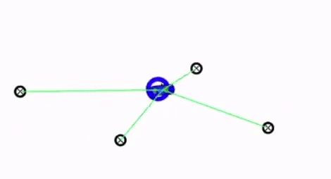

# 08 - Kidnapped Vehicle (Particle Filter)

Localizes a vehicle on a landmark map with a 2D particle filter in C++, from a noisy initial GPS estimate, noisy control data and noisy landmark observations streamed from the Udacity simulator.

> Part of [Self-Driving Car Engineer Nanodegree - Project Solutions](../README.md) - Project 8
> Status: coursework - Type: C++ program (simulator client) - Language: C++11 (CMake, uWebSockets)


<p align="center">
  
  <br>Qualitative result from the simulator.
</p>

## Overview

In this final project of the Udacity localization course the robot has been "kidnapped" and placed at an unknown location. The filter knows the map of landmarks, receives a noisy GPS-like estimate of the initial pose, and at each time step gets the control input (velocity and yaw rate) and the landmark observations in the vehicle frame. It maintains a set of pose hypotheses (particles), weights each by how well the observations match the map and resamples. The simulator grades accuracy and run time and prints `Success! Your particle filter passed!` when the filter meets its criteria.

## Data

- **Map:** [`data/map_data.txt`](data/map_data.txt) (42 lines), one landmark per row: x position (m), y position (m), landmark id. The map is in an arbitrary Cartesian system. Map data is provided by 3D Mapping Solutions GmbH (credit from the Udacity starter README).
- **Streamed data:** GPS, control and observation messages come from the Udacity Term 2 simulator, which is not part of this repository. Download it from the [simulator releases](https://github.com/udacity/self-driving-car-sim/releases).
- The program reads the map from `../data/map_data.txt`, so `data/` must stay next to `CMakeLists.txt` and the executable must be started from `build/`.

## Approach

All of the following is in [`src/particle_filter.cpp`](src/particle_filter.cpp), with parameters in [`src/main.cpp`](src/main.cpp):

1. **Initialization (`init`):** 100 particles drawn from Gaussians around the first GPS estimate (standard deviation 0.3 m for x and y, 0.01 rad for heading).
2. **Prediction (`prediction`):** every particle moves with the bicycle motion model using the previous velocity and yaw rate (with a straight-line special case for a near-zero yaw rate), then Gaussian noise is added. The time step is 0.1 s.
3. **Data association (`dataAssociation`):** observations are transformed from the vehicle frame to the map frame using each particle's pose and matched by nearest neighbour to the landmarks within the 50 m sensor range.
4. **Weight update (`updateWeights`):** each particle's weight is the product, over its observations, of a 2D Gaussian density centred on the matched landmark (landmark noise 0.3 m); weights are normalized to sum to one.
5. **Resampling (`resample`):** particles are redrawn with replacement in proportion to their weights.
6. **Output:** the particle with the highest weight is sent to the simulator as the pose estimate, together with its associations for visualization. `main.cpp` selects it after `resample()`, which resets every weight to 1, so it is effectively the first particle in the list rather than the most likely one.

The simulator protocol used by `main.cpp` (uWebSocketIO, port 4567):

| Direction | Fields |
|---|---|
| Simulator to program | `sense_x`, `sense_y`, `sense_theta` (noisy GPS, first message), `previous_velocity`, `previous_yawrate`, `sense_observations_x`, `sense_observations_y` |
| Program to simulator | `best_particle_x`, `best_particle_y`, `best_particle_theta`, and for debugging `best_particle_associations`, `best_particle_sense_x`, `best_particle_sense_y` |

## Results

No error figure or run log is stored in the repository. Pass or fail is decided by the simulator at run time (position and yaw error within the simulator's tolerances, finishing within its time limit). The upstream repository does not record the outcome, so none is claimed here.

## How to run

Requirements: `cmake >= 3.5`, `make >= 4.1`, `gcc/g++ >= 5.4`, uWebSockets at commit `e94b6e1`, and the Term 2 simulator.

```bash
./install-ubuntu.sh        # or ./install-mac.sh : builds and installs uWebSockets
./build.sh                 # creates build/ and compiles   (or: mkdir build && cd build && cmake .. && make)
./run.sh                   # starts ./particle_filter from build/
```

Then start the simulator and select this project in its menu. The helper scripts change into their own directory first, so they can be run from anywhere; `clean.sh` removes `build/`. On Windows use Docker, a virtual machine or Windows Subsystem for Linux.

## Project structure

```text
08-kidnapped-vehicle/
├── README.md
├── CMakeLists.txt             # builds the particle_filter executable
├── build.sh, run.sh, clean.sh # build, run and clean helpers (Udacity)
├── install-ubuntu.sh, install-mac.sh, cmakepatch.txt   # uWebSockets installation
├── data/
│   └── map_data.txt           # landmark map
├── img/
│   └── overview.gif           # figure used in this README
└── src/
    ├── main.cpp               # simulator I/O (uWebSockets) and parameters
    ├── particle_filter.{h,cpp}# the particle filter
    ├── helper_functions.h     # distance and file-reading helpers (Udacity)
    ├── map.h                  # landmark map structure (Udacity)
    └── json.hpp               # vendored nlohmann/json 2.1.1
```

## Limitations and known issues

- No numerical result is recorded; the filter can only be exercised with the simulator.
- Nearest-neighbour association and a fixed set of 100 particles are simple choices; performance under heavier noise is not evaluated.
- The reported pose is chosen after resampling, when all weights are equal (see step 6 of the approach), which makes the output an arbitrary particle.
- The `CMakeLists.txt` links `z ssl uv uWS`, so the uWebSockets installation must be done first.

## Credits

- Solution code copied from [ndrplz/self-driving-car](https://github.com/ndrplz/self-driving-car) (`project_8_kidnapped_vehicle`).
- Project specification, starter code and build scripts: Udacity Self-Driving Car Engineer Nanodegree. `particle_filter.h` and `helper_functions.h` credit Tiffany Huang, `map.h` credits `mufferm`.
- Map data: 3D Mapping Solutions GmbH, as noted in the Udacity starter README.
- [nlohmann/json](https://github.com/nlohmann/json) 2.1.1, MIT License, vendored in `src/json.hpp`.

## License

No license file - all rights reserved by the respective authors. nlohmann/json keeps its own license (MIT).
