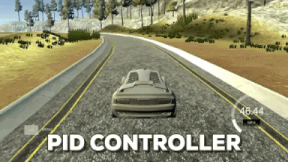
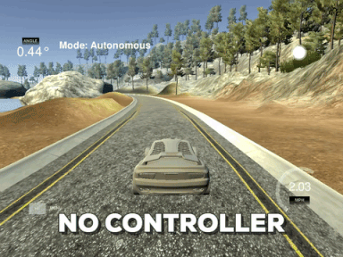
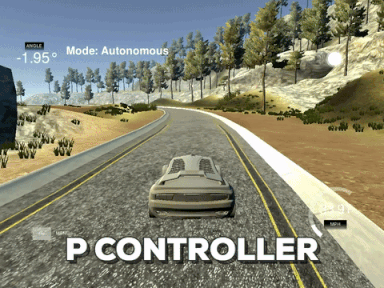
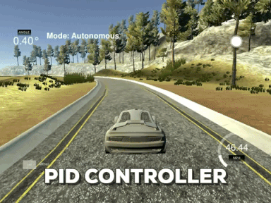

# 09 - PID Control

Steers the simulated car around the track with a PID controller that drives the cross-track error (distance from the lane centre) towards zero.

> Part of [Self-Driving Car Engineer Nanodegree - Project Solutions](../README.md) - Project 9
> Status: coursework - Type: C++ program (simulator client) - Language: C++11 (CMake, uWebSockets)


<p align="center">
  
  <br>Qualitative result from the simulator.
</p>

## Overview

A proportional-integral-derivative (PID) controller is one of the most common feedback mechanisms. Here the error is the cross-track error (CTE) reported by the simulator, and the controller output is the steering command. The program is a WebSocket client of the Udacity Term 2 simulator: for every telemetry message it updates the controller with the new CTE and replies with a steering angle and a fixed throttle. The three gains were tuned manually by watching the car's behaviour in the simulator.

| No control | P controller only | PID controller |
|---|---|---|
|  |  |  |

## Data

No data files. The program consumes live telemetry (`cte`, `speed`, `steering_angle`) from the Udacity Term 2 simulator, available from the [simulator releases](https://github.com/udacity/self-driving-car-sim/releases).

## Approach

1. **Error terms** ([`src/PID.cpp`](src/PID.cpp)): proportional is the current CTE, integral is the running sum of CTE values, derivative is the difference from the previous CTE.
2. **Control law:** `steering = -(Kp * p_error + Ki * i_error + Kd * d_error)`.
3. **Gains** ([`src/main.cpp`](src/main.cpp)): `Kp = 0.1`, `Ki = 0.0001`, `Kd = 1.0`, found by manual tuning. The throttle is fixed at 0.4.
4. **Role of each term:**
   - the proportional gain scales the correction with the current error; too high a value makes the car oscillate (see the "P controller" animation);
   - the integral gain accumulates error over time and removes steady-state offsets and systematic bias;
   - the derivative gain reacts to the rate of change of the error and damps overshoot.

## Results

No quantitative result is recorded. The behaviour is shown qualitatively by the animations above (no control, P only, full PID). Tuning was done by inspection. The upstream write-up notes that the parameters could be validated automatically if the simulator offered a headless mode; no automatic parameter search is implemented.

## How to run

Requirements: `cmake >= 3.5`, `make >= 4.1`, `gcc/g++ >= 5.4`, uWebSockets at commit `e94b6e1` and the Term 2 simulator.

```bash
./install-ubuntu.sh        # or ./install-mac.sh : builds and installs uWebSockets
mkdir build && cd build
cmake .. && make
./pid                      # listens on port 4567; then start the simulator
```

If uWebSockets is installed from source, check out commit `e94b6e1`; function signatures changed in v0.14.x.

## Project structure

```text
09-pid-control/
├── README.md
├── CMakeLists.txt            # builds the pid executable
├── install-ubuntu.sh, install-mac.sh, cmakepatch.txt   # uWebSockets installation
├── img/                      # GIFs used in this README
└── src/
    ├── main.cpp              # simulator I/O (uWebSockets), gains and throttle
    ├── PID.{h,cpp}           # PID controller
    └── json.hpp              # vendored nlohmann/json 2.1.1
```

## Limitations and known issues

- Gains were tuned by hand for a fixed throttle of 0.4 and are not adapted to speed.
- No quantitative evaluation (for example the mean CTE) is recorded.
- The integral term has no anti-windup limit.

## Credits

- Solution code and write-up copied from [ndrplz/self-driving-car](https://github.com/ndrplz/self-driving-car) (`project_9_PID_control`).
- Project specification, starter code, build and install scripts: Udacity Self-Driving Car Engineer Nanodegree (CarND-Controls-PID).
- [nlohmann/json](https://github.com/nlohmann/json) 2.1.1, MIT License, vendored in `src/json.hpp`.

## License

No license file - all rights reserved by the respective authors. nlohmann/json keeps its own license (MIT).
