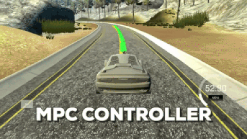

# 10 - Model Predictive Control (MPC)

Controls the simulated car's steering and throttle by repeatedly optimizing a short future trajectory against a polynomial reference path, while compensating for 100 ms of actuation latency.

> Part of [Self-Driving Car Engineer Nanodegree - Project Solutions](../README.md) - Project 10
> Status: coursework - Type: C++ program (simulator client) - Language: C++11 (CMake, CppAD, Ipopt, Eigen, uWebSockets)


<p align="center">
  
  <br>Qualitative result from the simulator.
</p>

## Overview

Model predictive control (MPC) optimizes the actuator commands over a finite horizon using a dynamic model of the vehicle. Unlike the [PID controller](../09-pid-control/) of project 9, it can anticipate upcoming path curvature, because future time steps are part of the optimization of the current command. At each telemetry message the program fits a polynomial to the reference waypoints, predicts the state forward by the latency, solves the optimization problem with Ipopt through CppAD, and sends the first steering and throttle commands back to the simulator.

## Data

- **Live input:** the Udacity Term 2 simulator sends waypoints, pose, speed, steering angle and throttle over a WebSocket. Download it from the [simulator releases](https://github.com/udacity/self-driving-car-sim/releases). The fields are described in [`websocket-data.md`](websocket-data.md).
- **Committed data:** [`data/lake_track_waypoints.csv`](data/lake_track_waypoints.csv) holds the waypoints (`x,y`, 70 rows) of the lake track. According to the Udacity starter notes it may not be fully in sync with the simulator, and no code reads it; it is useful for offline experiments such as fitting polynomials.

## Approach

1. **Frame change** ([`src/main.cpp`](src/main.cpp), lines 94-102): waypoints are shifted and rotated into the car's coordinate system, so the car starts at the origin heading along x.
2. **Reference path:** a third-order polynomial is fitted to the six transformed waypoints (`polyfit`). The cross-track error and heading error follow from the polynomial.
3. **Latency compensation** (`main.cpp`, lines 125-132 and 185): the state is predicted 0.1 s ahead using the current speed, steering angle and throttle before it is given to the solver, and the program sleeps 100 ms before sending the command to mimic actuation latency.
4. **Vehicle model** (`FG_eval` in [`src/MPC.cpp`](src/MPC.cpp), lines 117-123): a kinematic bicycle model with state x, y, heading `psi`, speed `v`, cross-track error `cte` and heading error `epsi`, and actuators steering `delta` and acceleration `a`; `Lf = 2.67`.
5. **Horizon:** `N = 10` steps of `dt = 0.1 s`, i.e. 1 s. These values were chosen empirically by watching the simulator (a larger `dt` makes actuation less frequent, a larger horizon costs more computation and looks too far ahead to be useful).
6. **Constraints:** steering limited to [-25, 25] degrees, acceleration to [-1, 1]. The initial state is fixed to the current (latency-corrected) state.
7. **Cost function** (`MPC.cpp`, lines 54-79): a sum of
   - tracking terms for cross-track error, heading error (weight 2000 each) and speed relative to `ref_v = 60` (weight 100);
   - an actuator-use term (weight 10);
   - smoothness terms on the change of steering (weight 100000) and acceleration (weight 10000) between steps.
8. **Output:** the first steering value, normalized by 25 degrees times `Lf`, and the first throttle value are sent to the simulator, along with the predicted trajectory and the reference line for display.

## Results

No quantitative result is recorded. The behaviour is shown qualitatively by the animation above. Performance has not been measured (for example mean cross-track error or lap time).

## How to run

Requirements: `cmake >= 3.5`, `make >= 4.1`, `gcc/g++ >= 5.4`, a Fortran compiler, [Ipopt](https://projects.coin-or.org/Ipopt) 3.12.1 or newer, [CppAD](https://www.coin-or.org/CppAD/), uWebSockets at commit `e94b6e1`, and the Term 2 simulator. Eigen 3.3.3 is vendored in `src/Eigen-3.3/`.

```bash
./install-ubuntu.sh            # or ./install-mac.sh : uWebSockets
sudo apt-get install gfortran cppad          # Linux; on macOS: brew install gcc ipopt cppad
bash install_ipopt.sh Ipopt-3.12.1           # Linux, if apt provides only Ipopt 3.11.x (pass the Ipopt source directory)
mkdir build && cd build
cmake .. && make
./mpc                          # listens on port 4567; then start the simulator
```

Notes for Linux from the starter instructions: the Ipopt available through `apt-get` is 3.11.x; if it does not work, build from source with `install_ipopt.sh`. Windows is not covered; use the Linux subsystem.

## Project structure

```text
10-mpc-control/
├── README.md
├── websocket-data.md          # description of the simulator's JSON fields (Udacity)
├── CMakeLists.txt             # builds the mpc executable (links ipopt z ssl uv uWS)
├── install-ubuntu.sh, install-mac.sh, install_ipopt.sh, cmakepatch.txt
├── data/
│   └── lake_track_waypoints.csv
├── img/overview.gif           # figure used in this README
└── src/
    ├── main.cpp               # simulator I/O, frame change, polynomial fit, latency handling
    ├── MPC.{h,cpp}            # optimization problem (CppAD + Ipopt)
    ├── json.hpp               # vendored nlohmann/json 2.1.1
    └── Eigen-3.3/             # vendored Eigen 3.3.3 (complete source tree)
```

## Limitations and known issues

- The line numbers quoted above refer to the files as committed; they will drift if the code is edited.
- Cost weights, horizon and the reference speed of 60 were tuned by hand for the simulator; no systematic evaluation is recorded.
- `src/Eigen-3.3/` is a complete Eigen source tree (documentation, tests and benchmarks included); only the `Eigen/` headers are needed to build.

## Credits

- Solution code and write-up copied from [ndrplz/self-driving-car](https://github.com/ndrplz/self-driving-car) (`project_10_MPC_control`).
- Project specification, starter code, install scripts and `websocket-data.md` (the former `DATA.md`): Udacity Self-Driving Car Engineer Nanodegree (CarND-Controls-MPC).
- [Eigen](https://eigen.tuxfamily.org) 3.3.3, Mozilla Public License 2.0, vendored in `src/Eigen-3.3/`.
- [nlohmann/json](https://github.com/nlohmann/json) 2.1.1, MIT License, vendored in `src/json.hpp`.
- [CppAD](https://www.coin-or.org/CppAD/) and [Ipopt](https://projects.coin-or.org/Ipopt) are external dependencies and are not included.

## License

No license file - all rights reserved by the respective authors. Eigen (MPL 2.0) and nlohmann/json (MIT) keep their own licenses.
