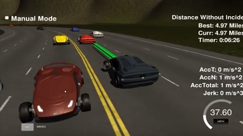

# 11 - Path Planning

Plans smooth, collision-free trajectories for a simulated car on a three-lane highway with other traffic, keeping close to the 50 MPH limit and changing lanes when a slower car is ahead.

> Part of [Self-Driving Car Engineer Nanodegree - Project Solutions](../README.md) - Project 11
> Status: coursework - Type: C++ program (simulator client) - Language: C++11 (CMake, uWebSockets)


<p align="center">
  
  <br>Udacity Term 3 simulator with the planned path (green line) ahead of the car.
</p>

## Overview

The Udacity Term 3 simulator sends the car's localization, the previous path and sensor-fusion data for all other cars on the same side of the road, and expects a list of (x, y) points. The car visits one point every 0.02 s, so the spacing of the points sets the speed. The task is to drive a full 6,946 m loop at up to 50 MPH without collisions, leaving the lane only to change lanes, and without exceeding 10 m/s^2 total acceleration or a jerk limit (50 m/s^3 in the Udacity project statement; the rubric text quoted in `model-documentation.md` says 10 m/s^3). This solution generates a spline through a few widely spaced Frenet waypoints, accelerates and brakes gradually, and uses simple rules based on sensor-fusion data to decide when to change lanes. A rubric-by-rubric explanation of the design is in [`model-documentation.md`](model-documentation.md), which is kept as written by the upstream author ("we" and "our car" refer to that author, and its line links point to commits of the upstream repository).

## Data

- **Map:** [`data/highway_map.csv`](data/highway_map.csv) (181 waypoints). Each row is `x y s dx dy`: map coordinates, distance along the road in metres, and the unit normal vector pointing outward of the loop. The Frenet `s` value runs from 0 to 6945.554 before wrapping. The program reads it from `../data/highway_map.csv`, so `data/` must stay next to `CMakeLists.txt` and the executable must be started from `build/`.
- **Simulator:** the Term 3 simulator with the Path Planning project, from the [simulator releases](https://github.com/udacity/self-driving-car-sim/releases). It is not part of this repository.

Telemetry fields received per message: car `x`, `y`, `s`, `d`, `yaw`, `speed`; `previous_path_x`, `previous_path_y`; `end_path_s`, `end_path_d`; and `sensor_fusion`, a list of `[id, x, y, vx, vy, s, d]` for each other car.

## Approach

All of the following is in [`src/main.cpp`](src/main.cpp) and the headers in [`src/`](src/):

1. **Lanes and constants** ([`utils.h`](src/utils.h)): lanes are 4 m wide, the car starts in lane 1 (the middle lane), the reference speed is capped at 49.5 mph, and the safety distance is 20 m.
2. **Cars ahead:** each other car in the same lane is projected forward by the length of the previous path; if one is ahead and closer than the safety distance, the car decelerates (0.224 mph per step, about 5 m/s^2) and prepares a lane change. Otherwise it accelerates by the same step up to the speed cap.
3. **Lane change:** with a car ahead too close, the left and right neighbouring lanes are checked for cars within half the safety distance in `s`. If a side is free, the `lane` variable moves one lane over. This small state logic is the "finite state machine" described in the model documentation.
4. **Trajectory:** the unused points of the previous path are kept for continuity. Three new Frenet waypoints at 30, 60 and 90 m ahead, centred in the target lane, are converted to map coordinates ([`coords_transform.h`](src/coords_transform.h)) and, together with the last two points of the previous path (at start-up, the car's position and a point just behind it), define a spline ([`spline.h`](src/spline.h)) in the car's local frame.
5. **Speed control:** the spline is sampled so that consecutive points are spaced for the current reference speed, filling the path up to 50 points, then rotated back to map coordinates and sent as `next_x` and `next_y`.

## Results

No quantitative result (distance without incident, lap time, maximum acceleration or jerk) is recorded in the repository. The behaviour is shown in the simulator; the screenshot above is from the Udacity simulator.

## How to run

Requirements: `cmake >= 3.5`, `make >= 4.1`, `gcc/g++ >= 5.4`, uWebSockets at commit `e94b6e1` and the Term 3 simulator.

```bash
./install-ubuntu.sh        # or ./install-mac.sh : builds and installs uWebSockets
mkdir build && cd build
cmake .. && make
./path_planning            # listens on port 4567; then start the simulator
```

In this folder `install-ubuntu.sh` has its `git checkout e94b6e1` line commented out, so it builds the default branch of uWebSockets; uncomment the line to get the pinned version that the code was written against (`install-mac.sh` pins it).

## Project structure

```text
11-path-planning/
├── README.md
├── model-documentation.md     # design notes per rubric point (links to the upstream repository)
├── CMakeLists.txt             # builds the path_planning executable
├── install-ubuntu.sh, install-mac.sh, cmakepatch.txt   # uWebSockets installation
├── data/
│   └── highway_map.csv        # highway waypoints
├── img/overview.jpg           # figure used in this README
└── src/
    ├── main.cpp               # simulator I/O, lane logic, trajectory generation
    ├── utils.h                # constants, Vehicle struct, lane helper
    ├── waypoints.h            # nearest-waypoint helpers
    ├── coords_transform.h     # Cartesian <-> Frenet conversion
    ├── spline.h               # cubic spline library (Tino Kluge, GPL)
    ├── json.hpp               # vendored nlohmann/json 2.1.1
    └── Eigen-3.3/             # vendored Eigen 3.3.3, see limitations
```

## Limitations and known issues

- The path planner has only been judged qualitatively in the simulator; no numbers are recorded.
- `src/Eigen-3.3/` is a complete Eigen source tree and `main.cpp` includes two of its headers, but no Eigen type is used anywhere in the sources. It was left in place because removing it would need an edit to the code.
- `main.cpp` line 247 initialises `target_y` from `s(target_y)`, the variable being defined, where `s(target_x)` appears to be intended. The code is kept as published.
- `model-documentation.md` links to specific commits of the upstream repository.
- Lane-change decisions are rule-based and do not model other cars' lane changes or predicted trajectories.

## Credits

- Solution code and model documentation copied from [ndrplz/self-driving-car](https://github.com/ndrplz/self-driving-car) (`project_11_path_planning`).
- Project specification, starter code, install scripts and the simulator: Udacity Self-Driving Car Engineer Nanodegree (CarND-Path-Planning-Project).
- `src/spline.h`: Tino Kluge, `http://kluge.in-chemnitz.de/opensource/spline/`, GNU General Public License v2 or later (see the file header).
- [Eigen](https://eigen.tuxfamily.org) 3.3.3, Mozilla Public License 2.0, in `src/Eigen-3.3/`.
- [nlohmann/json](https://github.com/nlohmann/json) 2.1.1, MIT License, in `src/json.hpp`.

## License

No license file - all rights reserved by the respective authors. Third-party components keep their own licenses: `spline.h` is GPL v2 or later, Eigen is MPL 2.0 and nlohmann/json is MIT.
