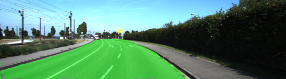

# 12 - Road Segmentation

Labels the road pixels in street images with a Fully Convolutional Network (FCN) built on a pretrained VGG16 encoder, trained on the KITTI road data set.

> Part of [Self-Driving Car Engineer Nanodegree - Project Solutions](../README.md) - Project 12
> Status: coursework - Type: Python scripts - Language: Python (TensorFlow)


<p align="center">
  
  <br>Qualitative result: the predicted road area (green) on a street image.
</p>

## Overview

Semantic segmentation assigns a class to every pixel. This project solves the two-class case (road versus not-road). It reuses the convolutional layers of a pretrained VGG16 network and adds 1 x 1 convolutions, skip connections from VGG layers 3, 4 and 7 and upsampling to the input resolution, in the style of the FCN paper of Long et al. The model is trained with random mirroring and colour augmentation and writes the segmented test images to disk.

## Data

- **KITTI Road data set:** download [`data_road.zip`](http://www.cvlibs.net/download.php?file=data_road.zip) from the [KITTI road benchmark](http://www.cvlibs.net/datasets/kitti/eval_road.php) and extract it into `data/`, which creates `data/data_road/` with `training/` and `testing/`. The code checks for 289 training images, 289 training labels and 290 test images (`project_tests.py`). Not committed (`data/` is in `.gitignore`).
- **Pretrained VGG16:** `data/vgg/` must contain `saved_model.pb` and `variables/`. `helper.py` contains `maybe_download_pretrained_vgg`, which downloads `vgg.zip` from `https://s3-us-west-1.amazonaws.com/udacity-selfdrivingcar/vgg.zip` and extracts it into `data/`, but `main.py` does not call it, so download and extract it yourself. Not committed.

## Approach

1. **Encoder** (`load_vgg` in [`main.py`](main.py)): load the VGG16 graph from the saved model and take the outputs of layers 3, 4 and 7.
2. **Decoder** (`layers`): a 1 x 1 convolution per tapped layer maps features to 2 class scores (L2 regularization 0.5). The layer 7 scores are resized to 10 x 36 and added to layer 4, the sum is resized to 20 x 72 and added to layer 3, and the result is resized to the input size of 160 x 576 and passed through a 15 x 15 convolution.
3. **Loss and optimizer** (`optimize`): softmax cross-entropy on the flattened pixels with the Adam optimizer.
4. **Labels** (`helper.gen_batch_function`): ground-truth images from KITTI are converted to two channels (background where the label colour is `[255, 0, 0]`, road elsewhere) at 160 x 576.
5. **Augmentation** ([`image_augmentation.py`](image_augmentation.py)): random horizontal mirroring (image and label together) and random hue, saturation and brightness changes in HSV space.
6. **Training** (`train_nn`): defaults are batch size 8, 100 batches per epoch, 30 epochs, learning rate 1e-4 and dropout keep probability 0.25; all can be changed with command-line options (`--batch_size`, `--batches_per_epoch`, `--training_epochs`, `--learning_rate`, `--augmentation`, `--gpu`). The mean loss per epoch is printed.
7. **Inference** (`helper.save_inference_samples`): pixels with a road probability above 0.5 are painted semi-transparent green on each test image, and the images are saved to a time-stamped folder inside `runs_dir`.

`main.py` first runs a few unit tests from [`project_tests.py`](project_tests.py) on the KITTI data, `load_vgg`, `layers`, `optimize` and `train_nn`, then trains.

## Results

No quantitative result is recorded in the repository: the training loss and any IoU or accuracy are not saved, and no benchmark submission is included. The figure above is a qualitative example from the upstream write-up.

## How to run

```bash
pip install -r requirements.txt     # needs a TensorFlow 1.x environment and an old SciPy, see below
# 1. put the KITTI data in data/data_road/ and the VGG model in data/vgg/
# 2. edit data_dir and runs_dir at the end of main.py (see below)
python main.py                      # add --gpu 0 --training_epochs 30 etc. as needed
```

- **Paths must be edited.** The last lines of `main.py` (210-211) set `data_dir` to `~/code/self-driving-car/project_12_road_segmentation/data` and `runs_dir` to `~/majinbu_home/road_segmentation_prediction`, which are the original author's locations; `image_augmentation.py` (line 65) and `main_27.py` (lines 280-281) contain the same data path. Point them at this folder's `data/` and any output folder.
- A GPU is strongly recommended; `main.py` warns when none is found.
- `main.py` asserts TensorFlow 1.0 or newer, but `helper.py` uses `scipy.misc.imread` and `scipy.misc.imresize` (removed in recent SciPy) and the network code uses `tf.contrib` and `tf.layers`, so it needs a TensorFlow 1.x environment with an old SciPy.

## Project structure

```text
12-road-segmentation/
├── README.md
├── requirements.txt
├── main.py                 # model, training loop, entry point
├── helper.py               # data batching, VGG download helper, saving test results
├── image_augmentation.py   # mirroring and HSV augmentation (plus a debug visualization)
├── project_tests.py        # unit tests run by main.py
├── main_27.py              # earlier Python 2.7 variant of main.py (see limitations)
├── __init__.py             # empty
└── img/                    # figures used in this README
```

## Limitations and known issues

- Data and the pretrained VGG model are not committed, and the scripts contain machine-specific paths (see "How to run").
- `main_27.py` describes itself as a "dirty and running file to use Python2.7" that duplicates parts of `main.py` and `helper.py`. It is kept because `image_augmentation.py` imports `gen_batch_function` from it in its debug function; the main training path (`main.py`) does not use it.
- No evaluation metric is computed; quality is judged by eye from the saved overlays.
- Legacy TensorFlow and SciPy APIs.

## Credits

- Code and write-up copied from [ndrplz/self-driving-car](https://github.com/ndrplz/self-driving-car) (`project_12_road_segmentation`).
- Project specification and starter material, and the hosting of the pretrained VGG16 model: Udacity Self-Driving Car Engineer Nanodegree.
- Data: [KITTI Vision Benchmark Suite, road benchmark](http://www.cvlibs.net/datasets/kitti/eval_road.php).
- Method: J. Long, E. Shelhamer and T. Darrell, [Fully Convolutional Networks for Semantic Segmentation](https://people.eecs.berkeley.edu/~jonlong/long_shelhamer_fcn.pdf), referenced in `main.py`.

## License

No license file - all rights reserved by the respective authors.
