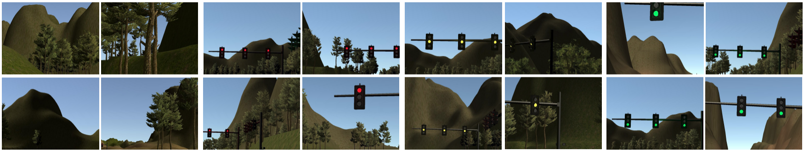
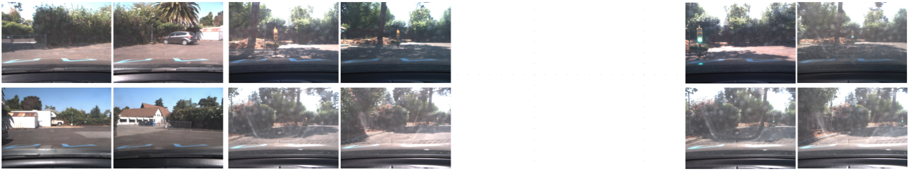

# 13 - Capstone: Traffic Light Classifier

Classifies the state of a traffic light (none, red, yellow or green) from a camera frame with a small convolutional network in TensorFlow, as a component for the nanodegree capstone project.

> Part of [Self-Driving Car Engineer Nanodegree - Project Solutions](../README.md) - Capstone
> Status: coursework - Type: Python scripts - Language: Python (TensorFlow, OpenCV)


<p align="center">
  
  <br>Sample frames from the simulator data set.
</p>

## Overview

In the capstone, the car must react to traffic lights. This component is a simple classifier that takes an RGB frame, resizes it and predicts one of four classes: `none`, `red`, `yellow`, `green` (label indices 0 to 3). It is trained on a data set that merges frames recorded in the Udacity simulator with frames from the Udacity real-world test circuit.

## Data

The data is not committed. The original README describes it as follows (these figures were not re-verified because the data is absent):

| Data set | Frames | Resolution | Classes |
|---|---|---|---|
| Simulator | 1,324 | 800 x 600 | none, red, yellow, green |
| Udacity circuit (real world) | 1,151 | 800 x 600 | none, red, green |
| Mixed (the two merged) | - | - | none, red, yellow, green |

- **Download:** all three data sets are in this [shared Google Drive folder](https://drive.google.com/open?id=0Bx9YaGcDPu3XSlMxeHlPZEIyRzQ) linked from the upstream README.
- **Expected format:** `train.py` reads a NumPy dump, `traffic_light_dataset_npy/traffic_light_dataset_mixed_resize_128.npy`, relative to this folder: an array of `[image, label]` rows with images resized to 128 x 128. `TrafficLightDataset.init_from_files(root, resize)` builds the array from a folder of `<root>/<subfolder>/*.jpg` images, taking the label from the words `none`, `red`, `yellow` or `green` in the file path, and `dump_to_npy` saves it.

Sample frames of the real-world data set:

<p align="center">
  
</p>

## Approach

1. **Preprocessing** (`TrafficLightDataset.preprocess` in [`traffic_light_dataset.py`](traffic_light_dataset.py)): subtract the mean and divide by the maximum, which puts values roughly in [-1, 1].
2. **Augmentation:** each training image is randomly flipped horizontally and vertically and rotated by multiples of 90 degrees.
3. **Model** ([`traffic_light_classifier.py`](traffic_light_classifier.py)): two 3 x 3 convolution layers (32 and 64 filters, ReLU, L2 regularization 1e-3), each followed by 2 x 2 max pooling, then flatten, dropout, a 4-unit ReLU layer and a 4-way softmax output.
4. **Training** ([`train.py`](train.py)): 128 x 128 inputs, Adam with learning rate 1e-4, batch size 32, dropout keep probability 0.5, 1,000 batches per epoch, cross-entropy loss. The script loops until it is stopped, prints the mean loss, and saves a checkpoint after every epoch to `checkpoint_mixed_128/`.
5. **Testing** ([`test.py`](test.py)): restores a checkpoint and shows predictions together with the images, for a random batch from a `.npy` file, a single image file or a directory of `.jpg` files.

## Results

No result is recorded in the repository. `train.py` prints the loss and an accuracy value to the console only. That accuracy is computed on random batches drawn from the same data set that is used for training, so it is not a held-out estimate and should not be read as test accuracy.

## How to run

```bash
pip install -r requirements.txt     # needs a TensorFlow 1.x environment, see below
# download the data and create traffic_light_dataset_npy/traffic_light_dataset_mixed_resize_128.npy
python train.py                     # runs until interrupted, checkpoints in checkpoint_mixed_128/
python test.py checkpoint_mixed_128/TLC_epoch_0.ckpt --mode from_npy \
    --data_path traffic_light_dataset_npy/traffic_light_dataset_mixed_resize_128.npy \
    --resize_h 128 --resize_w 128
```

- `test.py` takes the checkpoint path as its first argument and `--mode {from_npy, from_file, from_dir}` and `--data_path` as required options. Its default input size is 64 x 64, whereas `train.py` trains at 128 x 128, so pass `--resize_h 128 --resize_w 128` to test a checkpoint produced by `train.py`.
- Run from this folder; paths are relative. The code uses TensorFlow 1.x APIs (`tf.placeholder`, `tf.layers`, `tf.contrib`) and will not run unchanged on TensorFlow 2.

## Project structure

```text
13-capstone-traffic-light-classifier/
├── README.md
├── requirements.txt
├── train.py                      # trains the classifier and saves checkpoints
├── test.py                       # restores a checkpoint and shows predictions
├── traffic_light_classifier.py   # TrafficLightClassifier: CNN, loss, optimizer, accuracy
├── traffic_light_dataset.py      # TrafficLightDataset: loading, batching, augmentation
└── img/                          # sample frames used in this README
```

## Limitations and known issues

- Data and trained weights are not included.
- The training script reports accuracy on training data and has no separate validation or test split.
- The `test.py` default input size does not match the training size (see "How to run").
- The classifier distinguishes whole-frame states only; it does not localise the light in the image.

## Credits

- Code copied from [ndrplz/self-driving-car](https://github.com/ndrplz/self-driving-car) (`capstone_traffic_light_classifier`).
- Capstone project specification, simulator and the Udacity real-world test circuit data: Udacity Self-Driving Car Engineer Nanodegree.

## License

No license file - all rights reserved by the respective authors.
